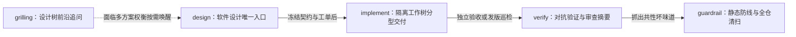

# docs

Taitide 工程研发方法论与正交 AI 代理技能库。

## 技能体系

整套研发与写作流程收敛为六枚职责正交、按需单跳加载的独立技能：



| 技能 | 核心职责 |
| :--- | :--- |
| [grilling](skills/grilling/SKILL.md) | 设计树前沿追问、方案推荐与越界阻断 |
| [design](skills/design/SKILL.md) | 战略建模、契约设计、交互设计、战术冻结、工单拆解与横切 ADR 唯一总入口 |
| [implement](skills/implement/SKILL.md) | 隔离工作树内对照冻结基线交付后端切片、客户端切片或端到端合龙 |
| [verify](skills/verify/SKILL.md) | 角色分离对抗验证、防投机核查、语义对齐与沙漏下口审查摘要生成 |
| [guardrail](skills/guardrail/SKILL.md) | 按信任倒金字塔将评审缺陷转化为类型、Clippy 与 `ast-grep` 防线 |
| [writing](skills/writing/SKILL.md) | 面向 AI 规则、Skill、技术文档与公共传播文案的写作规范 |

## 安装与校验

通过 `skills` CLI 一键安装至本机代理目录，或直接软链至 `~/.agents/skills/`：

```sh
bunx skills add taitide-labs/docs
```

本地提交前运行全套文档规范、Mermaid 渲染、离线死链、拼写与工作流安全校验：

```sh
mise install
mise run check
```

## 贡献与安全

请参阅 [贡献指南](CONTRIBUTING.md) 与 [安全政策](SECURITY.md)。

## 许可证

[MIT](LICENSE) © 2026 Taitide Labs
