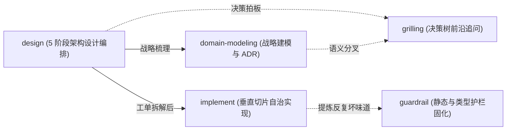

# docs

Taitide 工程研发方法论与正交 AI 代理技能库。

## 技能体系

各技能严格按照单一职责拆分为可独立触发、可逐层组合的正交单元：



| 技能                                              | 核心职责                                                 | 参考指南                                                                                                                                                                                                           |
| :------------------------------------------------ | :------------------------------------------------------- | :----------------------------------------------------------------------------------------------------------------------------------------------------------------------------------------------------------------- |
| [grilling](skills/grilling/SKILL.md)              | 设计树前沿追问、方案推荐与越界阻断                       | —                                                                                                                                                                                                                  |
| [domain-modeling](skills/domain-modeling/SKILL.md)| DMMF 战略划分、统一语言与单调递增 ADR                    | —                                                                                                                                                                                                                  |
| [design](skills/design/SKILL.md)                  | 战略、契约、原型、战术冻结与工单编排总路由               | [契约设计](skills/design/references/contract-design.md)、[原型与基线](skills/design/references/prototype-design.md)、[战术冻结](skills/design/references/tactical-design.md)、[任务拆解](skills/design/references/task-slicing.md) |
| [implement](skills/implement/SKILL.md)            | 隔离工作树内实现垂直切片、1 对 1 单测与冻结考卷激活      | —                                                                                                                                                                                                                  |
| [guardrail](skills/guardrail/SKILL.md)            | 将缺陷或坏味道下沉为类型、Clippy 与 `ast-grep` 硬性门禁  | —                                                                                                                                                                                                                  |

## 安装与校验

通过 `skills` CLI 一键安装至本机代理目录，或直接软链至 `~/.agents/skills/`：

```sh
bunx skills add taitide-labs/docs
```

本地提交前运行全套文档规范、Mermaid 渲染、离线死链、拼写与工作流安全校验：

```sh
mise install
mise run check
```

## 贡献与安全

请参阅 [贡献指南](CONTRIBUTING.md) 与 [安全政策](SECURITY.md)。

## 许可证

[MIT](LICENSE) © 2026 Taitide Labs
